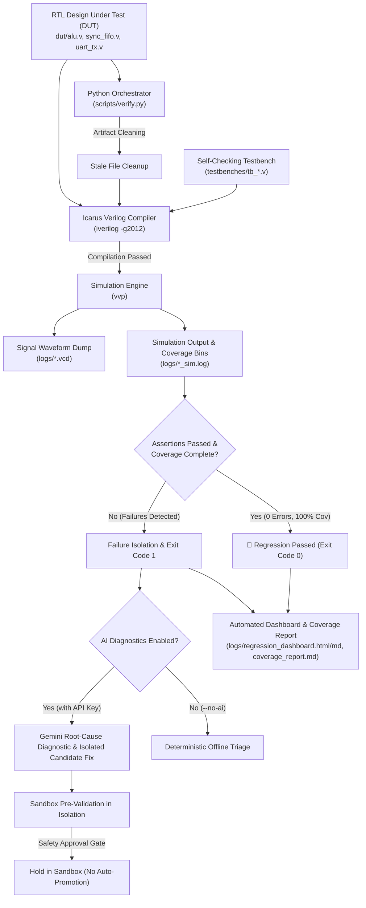

# AutoVerify-VLSI: Automated RTL Verification & Self-Healing Framework

[](https://github.com/pushkalgolla-svg/autoverify-vlsi/actions/workflows/verify.yml)

AutoVerify-VLSI is an automated digital design verification and diagnostic framework that bridges open-source electronic design automation (EDA) tools—**Icarus Verilog (`iverilog`)**, **VVP**, and **GTKWave**—with optional LLM orchestration using the **Google Gemini API**.

The framework provides robust, self-checking directed and constrained-random testbenches, cycle-accurate procedural assertion checkers, explicit binned functional coverage tracking, automated regression reporting, and isolated candidate patch synthesis for digital RTL IP cores.

> **Verification Methodology Note:**  
> This framework implements portable **Verilog-2012 procedural assertions and explicit binned functional coverage counters**. It deliberately avoids proprietary SystemVerilog UVM and formal verification tools to guarantee 100% open-source portability and reproducible execution across Linux, Windows, and GitHub Actions CI.

---

## 📦 Verified RTL Cores & Coverage Overview

| IP Module | Location | Testbench | Assertion Checks | Functional Coverage | Key Verification Scope |
| :--- | :--- | :--- | :---: | :---: | :--- |
| **ALU** | `dut/alu.v` | `testbenches/tb_alu.v` | 1,917 | **100.0%** (42/42 bins) | Multi-width parameterized verification across 8, 16, and 32 bits; all 4 opcodes; carry/overflow boundaries; borrow flag underflow boundaries (`a < b`); zero-result generation; extremum corners (MIN_MIN, MAX_MAX, MIN_MAX, MAX_MIN); 600+ randomized vectors. |
| **Sync FIFO** | `dut/sync_fifo.v` | `testbenches/tb_sync_fifo.v` | 13,407 | **100.0%** (46/46 bins) | Verified across `DEPTH=1`, `DEPTH=5`, and `DEPTH=16`; occupancy states (empty, 1-item, intermediate, almost full, full); read-only, write-only, and simultaneous R/W; simultaneous collisions at empty, full, and intermediate occupancy; overflow/underflow flags; modulo pointer wrap; 500-cycle randomized shadow queue verification. |
| **UART TX** | `dut/uart_tx.v` | `testbenches/tb_uart_tx.v` | 6,735 | **100.0%** (30/30 bins) | Bit-for-bit serial payload reconstruction; bit duration timing (`CLKS_PER_BIT`); all 4 parity modes (None, Odd, Even, Reserved `2'b11`); input patterns (All-0s, All-1s, Alternating 0x55/0xAA, Walking-1s); mid-frame parity latching; request rejection while busy; exact 1-cycle `tx_done` pulse; inter-frame gap measurements (0, 3, 7 delay cycles); 30 random frames. |
| **TOTAL** | — | — | **22,059** | **100.0%** (118/118 bins) | **Zero functional errors. 100% coverage goals met.** |

---

## 🛠️ Tool Requirements & Prerequisites

### 1. EDA Simulator & Waveform Viewer
- **Icarus Verilog (`iverilog`) & VVP (`vvp`)**
  - **Ubuntu / Debian:**
    ```bash
    sudo apt-get update && sudo apt-get install -y iverilog gtkwave
    ```
  - **Windows (winget):**
    ```powershell
    winget install Icarus.Verilog
    ```
    *Ensure `iverilog` and `vvp` are accessible on your system `PATH`.*
- **GTKWave**: Used for visual signal timing and transition inspection.

### 2. Python Environment
- Python `>= 3.10`
- Package manager: [`uv`](https://docs.astral.sh/uv/) (recommended) or standard `pip`.

---

## 🚀 Execution Commands

### 1. Run Complete Offline Regression & Coverage Suite (Deterministic / No API Key)
Execute automated regression and functional coverage across all RTL modules:
```bash
# Using uv:
uv run python scripts/verify.py --regression --no-ai

# Or with standard Python:
python scripts/verify.py --regression --no-ai
```
*Exit code: `0` if all assertions pass and coverage is met; `1` if any failure occurs (ideal for CI/CD).*

### 2. Run Verification on an Individual IP Core
```bash
# Verify ALU (8, 16, 32 bits + coverage)
python scripts/verify.py --dut dut/alu.v --no-ai

# Verify Synchronous FIFO (DEPTH 1, 5, 16 + coverage)
python scripts/verify.py --dut dut/sync_fifo.v --no-ai

# Verify UART Transmitter (Serial protocol checking + coverage)
python scripts/verify.py --dut dut/uart_tx.v --no-ai
```

### 3. Run Isolated AI-Assisted Self-Healing Demonstration
Demonstrate the automated diagnostic and candidate repair pipeline on an isolated faulty copy (`examples/faulty_rtl/alu_faulty.v`) without touching validated RTL:
```bash
# Offline demonstration (No API key required):
python scripts/demo_ai_healing.py --offline

# Or with live Gemini API key:
python scripts/demo_ai_healing.py
```
*Demonstration outputs isolated candidate fix (`examples/faulty_rtl/alu_candidate.v`), unified patch diff (`examples/faulty_rtl/alu_healing_patch.diff`), and diagnostic report (`examples/faulty_rtl/alu_healing_report.md`).*

### 4. Inspect Signal Waveforms in GTKWave
All testbenches generate portable VCD dumps in `logs/`:
```bash
gtkwave logs/alu.vcd
gtkwave logs/sync_fifo.vcd
gtkwave logs/uart_tx.vcd
```

---

## 📊 Verification Deliverables & Reports

Each regression run automatically generates project-relative deliverables in `logs/`:
- `logs/regression_dashboard.md`: Markdown summary table with status, total checks, and coverage metrics.
- `logs/regression_dashboard.html`: Modern, shareable HTML regression dashboard.
- `logs/coverage_report.md`: Dedicated functional coverage audit detailing all 118 bins and 22,059 assertion checks.
- `logs/<module>_sim.log`: Full cycle-accurate simulation output logs.
- `logs/<module>.vcd`: Signal transition traces for GTKWave debugging.

---

## 🏗️ Architecture & Safety Guardrails


