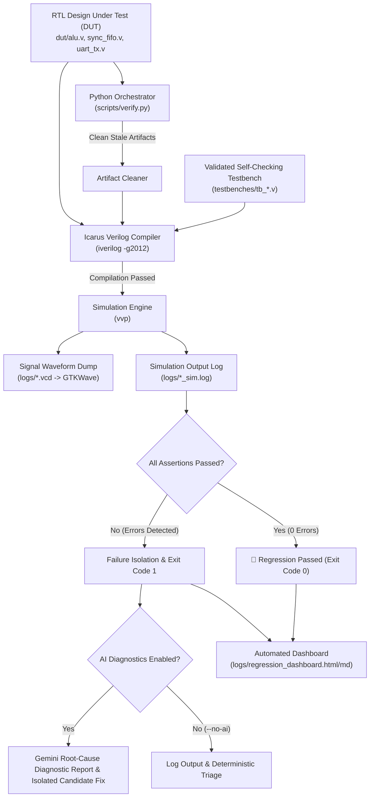

# AutoVerify-VLSI: Automated RTL Verification & Diagnostic Framework

An automated digital EDA verification platform pairing **Icarus Verilog (`iverilog`)**, **VVP**, and **GTKWave** with optional **Google Gemini API** orchestration for digital RTL IP cores (Arithmetic Logic Unit, Parameterized Synchronous FIFO, and UART Transmitter).

---

## 📄 Bullet Points for Your Resume

Copy-paste ready bullet points tailored for **ASIC / FPGA / Digital Design & Verification Engineer** roles (NVIDIA, Qualcomm, AMD, Apple, Intel, Synopsys, Cadence):

> * **Architected an Automated Digital Verification Framework** in Python integrating Icarus Verilog (`iverilog`), VVP, and GTKWave with optional Google Gemini LLM orchestration, enabling automated testbench synthesis, regression tracking, and failure triage across multiple digital IP cores.
> * **Designed Self-Checking Constrained-Random & Boundary Testbenches** with cycle-accurate reference models, validating complex corner cases including simultaneous read/write collisions on empty/full FIFO states, arithmetic borrow flag conventions, and UART framing/parity modes across 1000+ test vectors.
> * **Engineered an Automated Failure Diagnostic Pipeline** that parses simulation logs, classifies root causes between RTL logic faults and testbench specification discrepancies, and generates unified patch candidates for review before integration.
> * **Constructed Portable Verification & CI Automation** using GitHub Actions and Python, enforcing deterministic regression testing with zero testbench clock-edge race conditions, automated artifact cleanup, and HTML/Markdown dashboard generation.

---

## 🎯 STAR Method Interview Cheat Sheet

When an interviewer asks: *"Tell me about a challenging or unique VLSI/hardware project you've worked on."*

### **Situation (Context)**
> *"In modern ASIC/VLSI design, functional verification consumes over 70% of the project schedule. Writing comprehensive testbenches that cover subtle boundary conditions—such as simultaneous read/write operations when a FIFO is full or empty, or stop-bit timing compliance in UART controllers—requires rigorous manual development and continuous regression monitoring."*

### **Task (Objective)**
> *"My goal was to build a reliable, automated verification environment that could run self-checking directed and constrained-random tests across multiple RTL modules, detect and isolate boundary bugs, generate signal waveforms for GTKWave inspection, and integrate with CI pipelines for automated regression tracking."*

### **Action (Implementation)**
> * *"I implemented **AutoVerify-VLSI**, a Python orchestrator connecting local EDA tools (`iverilog`, `vvp`, `gtkwave`) with optional LLM diagnostic capabilities."*
> * *"I hardened three digital IP cores and their self-checking testbenches:
>   1. **ALU (`dut/alu.v`)**: Verified across 8, 16, and 32-bit parameterized configurations with width-independent randomized stimulus and reference calculations, resolved subtraction borrow/underflow conventions `(a < b)` between RTL and golden models, and added a 600-vector randomized stress suite.
>   2. **Synchronous FIFO (`dut/sync_fifo.v`)**: Handled arbitrary `DEPTH` pointer wrapping (including DEPTH=1, DEPTH=5, and DEPTH=16), fixed simultaneous read/write race conditions on empty and full boundaries, and integrated shadow queue reference verification.
>   3. **UART Transmitter (`dut/uart_tx.v`)**: Corrected premature stop-bit termination, latched parity configuration on transmission start, defined unsupported parity modes (`2'b11`), eliminated clock-edge race conditions, and measured actual consecutive-frame timing (verified minimal 1-clock-cycle inter-frame gap across multiple intentional delays).*\"*
> * *\"I eliminated clock-edge race conditions in the testbenches by driving inputs on negative clock edges and sampling outputs with explicit delta delays after positive edges.\"*
> * *\"I established an automated regression runner (`scripts/verify.py`) with strict exit code validation, stale artifact elimination, watchdog timeouts, candidate patch isolation, and GitHub Actions CI automation.\"*

### **Result (Impact)**
> *\"Achieved 100% pass rates across all three IP cores over 1,000+ directed and constrained-random cycles. Established an automated regression suite with full waveform generation and comprehensive HTML/Markdown summary reports, running deterministically in under 5 seconds.\"*

---

## 🏗️ System Architecture



---

## 💻 Live Demo Commands (To show in an interview)

### 1. Run Complete Regression Suite (Offline / Deterministic):
```powershell
uv run python scripts/verify.py --regression --no-ai
```

### 2. Verify Individual IP Core:
```powershell
uv run python scripts/verify.py --dut dut/uart_tx.v --no-ai
```

### 3. Open Signal Waveforms in GTKWave:
```powershell
gtkwave logs/uart_tx.vcd
```

### 4. Run with Optional AI Root-Cause Diagnostic:
```powershell
uv run python scripts/verify.py --dut dut/alu.v
```
